# Bevox Backend

The domain API and **execution control plane** behind an AI agent platform. Messages arrive from WhatsApp and Instagram. The backend turns each burst into a single agent "execution" and dispatches it over a queue to a separate LLM harness, [bevox-agent-harness](https://github.com/bernardTavares/bevox-agent-harness). It then decides what the AI may actually do (reply, book, charge, refund) through autonomy modes and human approval.

It is the business backend of **Bevox**, an AI secretary for appointment-based businesses (clinics first), built by one person. Messaging goes through [bevox-meta-api](https://github.com/bernardTavares/bevox-meta-api).

> **Status:** v1.0.1. Published as a reference design for an agent control plane. The autonomous audit reports are in `docs/audits/`.

## The core idea: the backend owns state, the harness owns reasoning

The backend does no LLM reasoning at all. The two services talk through a written contract:

- **Dispatch.** A BullMQ producer creates an `executions` row and mints a per-execution token, storing only its SHA-256 hash. It validates the payload with Zod and enqueues the job with `jobId = execution_id`, so enqueueing is idempotent.
- **Callbacks.** The harness reports back only through four token-gated endpoints: `PATCH /status`, `POST /traces`, `POST /stream` and `POST /complete`.
- **Lifecycle extras:**
  - a `deadline_ms` anchored to the DB clock, so retries never extend the budget;
  - replay lineage through `original_execution_id`, so the harness can dedupe side effects when staff replay an execution;
  - an authoritative `dead_letter` status that never overwrites a completed execution.

## What's inside

| Area | What it does |
|---|---|
| **Burst intake** | Inbound Meta events are resolved to a channel and a customer. Each conversation gets a **buffer window**, so five quick WhatsApp messages become one agent turn. A delayed cutoff job claims the conversation with a CAS lease, which allows at most one active execution per conversation, and dispatches exactly once. |
| **Progressive autonomy** | Three modes: `manual_assisted`, `copilot` and `autonomous_supervised`. A channel setting overrides the organization profile, which overrides the default. `/complete` either delivers the result directly or holds it as `waiting_approval`. **Any refund or charge proposal forces human approval, even in the most autonomous mode**, and the approver is recorded in the audit trail. |
| **Honest seams** | Side effects go through interfaces shaped like the final integrations. Approved actions (booking, waitlist, charges and refunds) execute for real; where an integration is still pending, the seam records a durable pending state and **never fakes success**. |
| **Payments** | Stripe Connect Express plus a manual payment mode. Idempotency is enforced at three layers: the HTTP `Idempotency-Key`, deterministic refund keys, and partial unique constraints in the database. Other safeguards: an over-refund guard, amounts in integer cents, reconcile crons for stuck intents and refunds, and signed, deduplicated webhooks. |
| **Calendar** | Booking with concurrency and idempotency handling, availability, a waitlist, and two-way Google Calendar sync. Sync loops are prevented with `extendedProperties`, etag and a tolerance on `synced_at`. |
| **Platform** | Three auth paths (Clerk JWT for end users, staff JWT with three RBAC roles, execution tokens). Every query is scoped to an organization. Also: opt-in Redis idempotency per route, AES-256-GCM for secrets at rest, Pino with LGPD-aware redaction, OpenTelemetry, Sentry, and a DSR export endpoint. |
| **Contract** | An OpenAPI 3.1 spec (80 paths) that generates the TypeScript types. `skills/bevox-backend-consumer/` is a Claude Code skill that teaches other repos' coding agents how to integrate. |
| **Delivery** | Multi-stage Docker image with `runtime` and `migrator` targets. A build gate fails if raw path aliases leak into `dist/`. CI runs lint, typecheck, unit tests, testcontainers integration tests and the build, plus CodeQL, OSV-Scanner and SemVer releases to GHCR. |

Size: about 24k lines of TypeScript, 15 route modules, 45 tables across 21 migrations, all keyed by UUIDv7.

## Architecture

```mermaid
flowchart LR
  WA[WhatsApp / Instagram] --> META[bevox-meta-api]
  META -- signed webhook --> IN[inbound: HMAC + normalize]
  IN --> Q1[(BullMQ ingestion)]
  Q1 --> INTAKE[intake: resolve customer,<br/>open / extend buffer window]
  INTAKE --> Q2[(delayed cutoff)]
  Q2 --> CUT[cutoff: CAS claim +<br/>resolve autonomy mode]
  CUT --> DISP[dispatcher: mint token,<br/>executions row]
  DISP --> Q3[(execution.dispatch)]
  Q3 --> H[bevox-agent-harness]
  H -- token-gated callbacks --> CB[status / traces / stream / complete]
  CB --> DEC{autonomy mode +<br/>suggestion type}
  DEC -- autonomous reply --> DELIV[deliver]
  DEC -- otherwise --> APPR[waiting_approval → staff]
  APPR --> EXEC[execute: calendar / payments / refund]
  DELIV --> META
```



## Quick start

```bash
git clone https://github.com/bernardTavares/bevox-backend.git && cd bevox-backend
corepack enable && pnpm install --frozen-lockfile    # Node 22
pnpm typecheck && pnpm lint && pnpm build
pnpm test                 # 469 unit tests
pnpm test:integration     # 93 tests on testcontainers Postgres + Redis (needs Docker)
```

Known rough edges:
- **Integration teardown.** The suite reports two errors after all 93 tests pass: Postgres connections are still open when the containers stop (`57P01`).
- **Postgres image.** The database needs **pg_uuidv7**, and plain `postgres:16-alpine` doesn't have it.
- **Policy enforcement.** The per-action policy JSONs (`allowed_actions`, `required_approvals`, `confidence_thresholds`) are stored but not yet enforced. A `PolicyEvaluator` seam marks where that check goes.
- **Specs live elsewhere.** The PRD and ADRs this code cites were kept in a separate, private knowledge repository.

## How this was built

As one person, AI-native. 318 of the 328 original commits were written by Claude Code under explicit rules:
- `CLAUDE.md` holds non-negotiable invariants and an act-vs-ask table. The agent stops on structural decisions without an ADR, on new dependencies and on plugin bypasses.
- `.claude/` holds 8 specialised reviewer agents, 7 path-bound rules and warn-only hooks.

After the build, a nightly headless Claude Code audit sent 7–16 parallel domain auditors over the code, each finding checked adversarially. The first run found 3 critical pilot blockers, and about 17 fix PRs landed within 48 hours. Later runs on unchanged code kept repeating the same verdict. The lesson: autonomous loops need a "stop when the marginal value is zero" exit condition.

Docs, comments and audits are in Portuguese. The code, the API contract and this README are in English.

## License

[Functional Source License 1.1, MIT Future License](./LICENSE.md) (FSL-1.1-MIT). Copyright 2026 Bernard Tavares.

You may use, modify and redistribute it for any purpose except a competing commercial product or service. Each version becomes MIT-licensed two years after its release.
